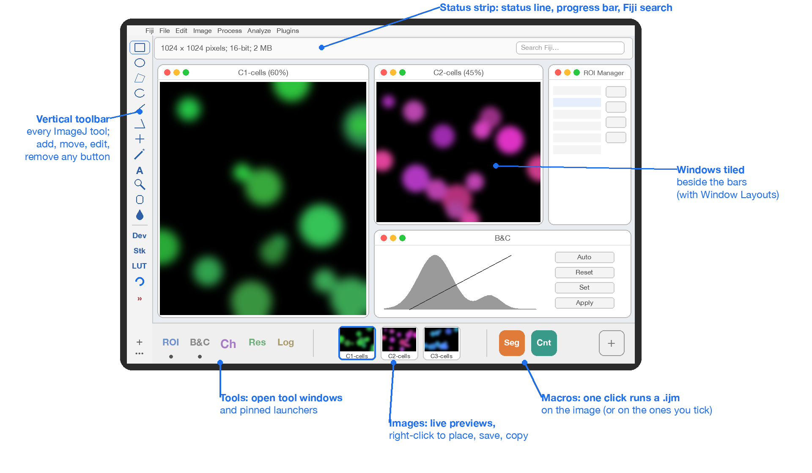

<h1 align="center">Fiji Side Toolbar</h1>

<p align="center"><b>Fiji's toolbar as a vertical bar you can reshape freely, plus a shelf for your open tools, your images and your macros.</b></p>

<p align="center">
  
  
  <a href="LICENSE"></a>
  
  
</p>

<p align="center">
  <a href="#why">Why</a> ·
  <a href="#highlights">Highlights</a> ·
  <a href="#quick-start">Quick start</a> ·
  <a href="#installation">Installation</a> ·
  <a href="#the-shelf-open-tools-image-previews-macro-buttons">The shelf</a> ·
  <a href="#going-back-to-imagejs-horizontal-toolbar">Back to the classic toolbar</a>
</p>



## Why

Fiji's toolbar is a fixed horizontal strip: its buttons cannot be moved, renamed or replaced, and on a wide screen it takes height that images need. **Side Toolbar** turns it into a vertical bar along the edge of the screen in which every button can be added, moved, edited or removed, and adds a **shelf**: a bar that shows the tool windows you have open, a live preview of every open image and one button per macro.

ImageJ's own toolbar keeps running, hidden, underneath: every tool behaves exactly as before, including tools that macros and plugins install later.

## Highlights

| Feature | What you get |
|---|---|
| **Every ImageJ tool, unchanged** | click to select, double-click for options, right-click for the tool's menu |
| **Reshape it by dragging** | drag a button to move it, drag it off the bar to remove it; every change can be undone |
| **Add anything** | **+** searches every Fiji command and tool; macro and script files dropped from the Finder or Windows Explorer become buttons |
| **Your own buttons** | any name, ImageJ tool picture, image file, letters or emoji as the icon; groups of buttons; springs |
| **A shelf for your work** | open tool windows (and pinned launchers, like the macOS Dock), live image previews, one-click macros |
| **Image previews that act** | right-click a preview to place it on the screen, duplicate, copy, zoom, save as TIFF, PNG, JPEG, PDF and more |
| **Macros on chosen images** | a macro button runs on the front image, on the images you tick, or (optionally) on every image of a folder |
| **Fits your screen** | one, two or three columns; shelf bars at the bottom, the top, beside the toolbar, at the right edge or floating; drag a bar's edge to resize it |
| **Easy to leave** | one command brings ImageJ's horizontal toolbar back; deleting two files uninstalls it |

## Quick start

1. Install the two files (see [Installation](#installation)) and restart Fiji. The bar appears on the left, the shelf at the bottom.
2. Click a tool as before. **Drag** a button to move it; drag it **off the bar** to remove it.
3. Click **+** at the bottom of the bar, type a command name (for example *Gaussian*), and drag the result onto the bar.
4. Open an image: its preview appears in the shelf. **Right-click** it for placement, copy and save commands.
5. Drop a `.ijm` macro on the shelf's right section: it becomes a button that runs on your images.

## Three plugins that work together

Each plugin works on its own; installed together, they share the screen and each other's commands.

All three are written in Java 8 for any system Fiji runs on, and their shortcuts follow your system: **Cmd** on macOS, **Ctrl** on Windows and Linux. So far they have been tested on macOS only; reports from Windows and Linux are welcome in each repository's *Issues*.

| Plugin | What it gives you |
|---|---|
| **Side Toolbar** (this one) | Fiji's toolbar as a vertical bar you can reshape freely, plus a shelf for open tools, live image previews and macro buttons |
| [**Window Layouts**](https://github.com/AIHector/Fiji-Window-Layouts) | Ten numbered window layouts, snap zones and exact saving of any arrangement, with a keyboard shortcut for each |
| [**Undo History**](https://github.com/AIHector/Fiji-Undo-History) | Multi-level undo and redo with a history panel: pixels, selections, overlays, display, calibration, ROI Manager and Results |

- **Window Layouts** keeps every layout clear of Side Toolbar's bars and status strip, and re-arranges the windows when a bar changes size or place.
- **Side Toolbar**'s image previews offer Window Layouts' placements (halves, thirds, quarters, other display, layouts 0 to 9) and Undo History's steps in their right-click menu.
- **Side Toolbar** adds an *Undo History* button to the bar when Undo History is installed, and **Window Layouts** places the Undo History window like any other tool window.

## The toolbar in detail


- **All of ImageJ's tools, unchanged.** Click to select a tool, double-click for its options, right-click (or hold the mouse button) for its menu: rectangle types, line types, point/multi-point, zoom menu, colour picker menu, macro and plugin tools, menu tools (*Dev*, *Stk*, *LUT*) and the **»** menu that switches toolsets.
- **Move a button:** drag it. The other buttons slide aside to show where it will land.
- **Remove a button:** drag it off the bar (a red cross appears on it), or right-click › **Remove**. Every change can be undone.
- **Add buttons:** click **+** at the bottom of the bar and search every Fiji command and tool. Double-click an entry, or drag it onto the bar where you want it. Macro and script files dragged onto the bar from the Finder or Windows Explorer become buttons.
- **Open images:** drag image files or folders from the Finder (or Windows Explorer) onto the bar; they open in Fiji, as they did when dropped on ImageJ's old toolbar (the bar is outlined in blue while you drag).
- **Two small buttons at the bottom:** **+** (above) adds buttons; **•••** (below) holds the bar's own menu (settings, undo, export, import, reset, classic toolbar, help). They are compact rows, so the default toolbar still fits one column on a 14-inch screen.
- **Undo History:** when that plugin is installed, an *Undo History* button (a blue curved arrow) is added once, above **»**.
- **Edit a button:** name, icon, command options, macro code. Icons can be ImageJ's tool pictures, the icons of macro tools, image files, letters or emoji.
- **Groups:** one button that opens a menu of buttons.
- **Springs:** empty space that pushes the buttons below it to the bottom of the bar.

Everything is saved as soon as you change it.

## How it works with Fiji's window

ImageJ's own toolbar is hidden, not removed: it keeps running underneath, and the side toolbar drives it. This is why every tool behaves exactly as before, including tools that macros and plugins install later.

Without its toolbar, the ImageJ window keeps only its status line, progress bar and Fiji's search bar. Side Toolbar turns it into a **status strip** across the top of the screen (or the bottom), beside the bar. The strip keeps its title bar: on macOS a window without one cannot receive typing, so Fiji's search bar and Cmd+Q would stop working. When you type in Fiji's search bar, the results open below it, as before.

The strip keeps the height the ImageJ window has, so on Windows and Linux, where Fiji's menus are inside that window, the menus stay in the strip.

The bar never takes the keyboard focus, so clicking a tool leaves your image active and Fiji's menu bar unchanged.

**Window Layouts.** If the Window Layouts plugin is installed, its layouts fill the screen *beside* the bar and below (or above) the status strip. Changing the bar's side or width re-arranges the windows.

## Installation

**From a release.** Download `Side_Toolbar-<version>.zip` from the [Releases](../../releases) page, unzip it, and copy the two files into your Fiji folder (the one that contains `plugins/` and `macros/`: `Fiji.app` on Windows and Linux; on macOS, `Fiji.app` or the folder that contains it):

| File | Where |
|---|---|
| `Side_Toolbar.jar` | `plugins/` |
| `Side_Toolbar_Startup.ijm` | `macros/AutoRun/` (shows the bar when Fiji starts) |

**From the source** (macOS; the script uses the Java inside Fiji, so nothing else is needed), with Fiji closed:

```bash
git clone https://github.com/AIHector/Fiji-Side-Toolbar.git
cd Fiji-Side-Toolbar
./test.sh    # 95 headless unit tests
./build.sh   # compiles with Fiji's own Java, installs both files
```

`build.sh` installs into `/Applications/Fiji` unless you give another Fiji folder (`./build.sh /path/to/Fiji`).

Then start Fiji. To uninstall, delete the two files; ImageJ's toolbar comes back unchanged.

## Using the bar

### Tools

| Action | Effect |
|---|---|
| Click | Selects the tool (as on ImageJ's toolbar) |
| Double-click | The tool's options (Point Tool, Wand Tool, Fonts, line width, Roi Defaults, ...) |
| Right-click, or press and hold | The tool's menu (rectangle / rounded / rotated; straight / segmented / freehand / arrow; zoom commands; colours), then the button's own entries |
| Click *Dev*, *Stk*, *LUT* (menu tools) | Their menu |
| Click **»** | Switch toolsets, add ImageJ's extra tools (Brush, Pencil, Arrow, Pixel Inspector, ...) |

A small red triangle marks a tool that has a menu, as on ImageJ's toolbar. The selected tool is highlighted. Moving the mouse over a button shows ImageJ's usual hint in the status strip and, after a moment, a tooltip beside the bar.

When a toolset or plugin adds a tool to ImageJ's toolbar, it appears on the side toolbar just above **»**. When a toolset is switched off, its buttons are hidden but keep their place for the next time. A tool you removed yourself is not added back.

### Command, macro and script buttons

A click runs the command, macro or script. Commands without options open their dialog, as from the menu; with options (for example `sigma=2 stack`) they run directly. The options are the text the Macro Recorder writes (*Plugins › Macros › Record...*).

### Changing the bar

| To | Do |
|---|---|
| Move a button | Drag it; release where the dashed gap is |
| Remove a button | Drag it off the bar until a red cross appears, release; or right-click › Remove |
| Undo | The notice "Removed ... Undo" that appears beside the bar, or right-click › Undo, or **•••** › Undo, or *Plugins › Side Toolbar › Undo Side Toolbar Change* |
| Add buttons | **+** › Add Buttons..., search, double-click or drag onto the bar |
| Add a recent command | **+** › Recent Commands |
| Add a macro / a script file | **+** › Macro Button... / Script or Macro File..., or drag the file from the Finder or Windows Explorer onto the bar (.ijm .py .groovy .js .bsh .rb .clj .scala .r) |
| Open an image or a folder | Drag it from the Finder (or Windows Explorer) onto the bar |
| Put a button in a group | Drag it onto the middle of the group button (the group is highlighted) |
| Add a separator, spring, group | **+** menu, or right-click a button › Insert Below |
| Edit | Right-click › Edit Button... |
| Copy a button | Right-click › Duplicate |

### The Edit dialog

| Field | Meaning |
|---|---|
| Name | Tooltip text and the label in label mode. Empty = automatic |
| Command, Options | The Fiji command (**Choose...** searches them) and its options |
| Macro code | ImageJ macro language |
| File, Argument | A macro or script file; `.ijm` files get the argument with `getArgument()`, other languages run through Fiji's *Run...* |
| Buttons (groups) | The group's buttons, with Up, Down, Edit, Add, Separator, Remove |
| Icon | **Automatic**: tools show their own icon, other buttons a coloured badge with their initials. **Letters or emoji**: up to three characters. **ImageJ icon code**: the language of macro tool icons (see imagej.net/ij/developer/macro/macros.html#icons). **Image file**: PNG, GIF or JPEG. **Picture of an ImageJ tool**. **Gallery...** offers all of these ready-made. **Colour...** sets the colour of letters and badges |

### Settings

**•••** › *Side Toolbar Settings...* or *Plugins › Side Toolbar › Side Toolbar Settings...*

| Setting | Choices | Default |
|---|---|---|
| Side of the screen | Left, Right | Left |
| Button size | 26, 32, 40, 50 px | 32 px |
| Columns | Automatic, 1, 2, 3 | Automatic: one column, a second only when the buttons do not fit the screen's height. With 1, 2 or 3 the bar keeps that many columns, and adds one only if the buttons would not fit. Widths with 32 px buttons: 40, 74, 108 px |
| Show button names beside the icons | on/off | off |
| ImageJ status bar | Top, Bottom, Classic ImageJ window (both toolbars) | Top |
| Keep the toolbar above Fiji's windows | on/off. Only while Fiji is the active application; other applications can cover it | on |

### Menu commands (Plugins › Side Toolbar)

Start Side Toolbar · Add Buttons to Side Toolbar... · Side Toolbar Settings... · Undo Side Toolbar Change · Export Side Toolbar... · Import Side Toolbar... · Reset Side Toolbar... · Show Classic Toolbar · Side Toolbar Help

- **Export / Import** save and load the bar's contents as a text file, to keep versions or share them.
- **Reset** restores ImageJ's tools in their usual order (undoable).
- **Show Classic Toolbar** brings back ImageJ's own toolbar and window and switches the side toolbar off, also at the next start. *Start Side Toolbar* switches it on again with the same buttons.

## The shelf: open tools, image previews, macro buttons

A second kind of bar, the **shelf**, sits at the bottom of the screen by default (56 px high), between the toolbar and the right edge. It has three sections:

| Section | Shows | Click | Right-click |
|---|---|---|---|
| **Tools** (left) | the tools you pinned (ROI Manager, B&C, Channels, Results, Log, Undo History by default), then any other open tool window. A dot under a tool means its window is open; a faded tool is closed | open tool: bring it to the front; closed tool: open it | bring to front, close the window, keep it in the shelf (pin), rename / initials / icon (an open tool that is not pinned is pinned when renamed, so that its name is kept), move earlier or later, remove |
| **Images** (centre) | a live preview of each open image (redrawn at most twice a second); the active image is outlined in blue. Many images scroll with the mouse wheel | bring the image to the front | **Name in the Shelf** (a name shown only by the shelf, for this session; the image keeps its title), Duplicate, Copy to Clipboard (to paste in other apps), Copy (ImageJ), **Place on Screen** (halves, quarters, thirds, centre, whole screen, back to where it was), **Move to Display** (next, previous), **Apply Layout** (0 to 9), **Zoom**, **Image** (rename, properties, info), **Undo History**, Save, **Save As** (TIFF, PNG, JPEG, GIF, BMP, TIFF in ZIP, OME-TIFF through Bio-Formats, AVI for stacks, PDF with one page per plane), Close |
| **Macros** (right) | one button per macro file (.ijm), with a name, initials or icon you choose; **+** adds one | runs the macro: on the image if one is open; with several, a dialog asks which (the active one is ticked; *All open images* ticks them all) | run, run on chosen images, edit the macro, rename / initials / icon, move, remove (the file stays) |

**Adding macros:** **+** › *Add Macro File (.ijm)...*, or *New Macro...* (creates the file in Fiji's `macros/Side Toolbar` folder and opens it in the editor), or drop .ijm files on the shelf. Images dropped on the shelf open in Fiji.

**Every image in a folder (optional).** Off by default, to spare memory. When switched on in the settings, the image dialog offers it: each image of the folder is opened without being shown, processed, saved as TIFF in a folder you choose, and closed before the next, so only one is in memory at a time.

**Moving things.** Right-click an empty part of a section:

- *‹Section› Section* › move it **to the bottom bar**, **to a bar at the top**, **as a column beside the toolbar**, **as a column at the right edge**, or **to a new floating bar**; move it left or right (up or down) within its bar; hide it.
- *This Bar* › place the whole bar at the bottom, at the top, beside the toolbar, at the right edge, or floating; show hidden sections again; size and options; undo the last bar change.

A floating bar moves when you drag its empty area; **drag it onto a docked bar** (it is outlined in blue) and its sections join that bar where you drop them (on the right of the activity bar if you drop it there). Every position in these menus has a small picture of where things go on the screen. Descriptions shown when the mouse rests on a button open on the side away from the bar and always fit on the screen. Bars and columns stay open until you close or hide them; docked ones push the windows aside (Window Layouts keeps clear of all of them).

**Size.** Drag the edge of a bar that faces the middle of the screen (the top edge of a bar at the bottom, the right edge of a column beside the toolbar, the bottom edge of a floating bar); the pointer becomes a resize arrow there. All bars take the new size (36 to 120 px), and the windows move aside when you release the mouse.

**Settings** (*+* › *Side Toolbar Settings...*): show the shelf, its size (36 to 120 px: the height of a bar, the width of a column), and whether macros may run on a whole folder.

The shelves are saved in `IJ_Side_Toolbar_Shelves.txt`, in ImageJ's settings folder, after every change.

## Going back to ImageJ's horizontal toolbar

- **To show it:** **•••** › *Show Classic Toolbar* (or *Plugins › Side Toolbar › Show Classic Toolbar*). The side toolbar and the shelf close, ImageJ's own window with its horizontal toolbar comes back, and it stays so at the next start.
- **To hide it again:** *Plugins › Side Toolbar › Start Side Toolbar*. Your buttons and shelves come back as they were.
- **Both at once:** *Side Toolbar Settings...* › *ImageJ status bar* › *Classic ImageJ window (with its own toolbar too)*.

## Files

All three are in ImageJ's settings folder: `~/Library/Preferences/` on macOS, `.imagej` in your home folder on Windows and Linux.

| File | Content |
|---|---|
| `IJ_Side_Toolbar.txt` | The bar's buttons, one per line (readable; edit only with Fiji closed) |
| `IJ_Side_Toolbar_Shelves.txt` | The shelf bars: their places, sections and pinned buttons |
| `IJ_Prefs.txt` | The settings, keys `sidetoolbar.*` |

The contents file is written through a temporary file, so a crash never leaves it half-written. Example:

```
tool	target=rectangle
separator
slot	target=Stacks Menu Tool
command	target=Gaussian Blur...	args=sigma=2	label=Blur 2	icon=text:G
group	label=Filters
  command	target=Median...
end
spring
more
```

## For developers

Other plugins can keep clear of the bar: it publishes its rectangle (screen coordinates) as the system property `sidetoolbar.reserved`, a `java.awt.Rectangle`, removed when the bar is off. Window Layouts uses it.

| Source | Content |
|---|---|
| `src/sidetoolbar/Side_Toolbar.java` | menu commands, settings |
| `src/sidetoolbar/Dock.java` | the bar: layout, animation, dragging, menus |
| `src/sidetoolbar/Bridge.java` | drives ImageJ's own toolbar |
| `src/sidetoolbar/Chrome.java` | places the bar and the status strip |
| `src/sidetoolbar/Icons.java`, `Gallery.java` | icons (ImageJ's drawings and icon language, redrawn as vectors) |
| `src/sidetoolbar/Editor.java` | Add and Edit dialogs |
| `src/sidetoolbar/Item.java`, `Store.java` | button model, file format, undo |
| `test/sidetoolbar/StoreTests.java` | headless unit tests (`./test.sh`) |
| `test/harness/sidetoolbar/TestHarness.java` | development-only live-test helper (not installed) |

Requires Fiji with ImageJ 1.54 or later; compiled for Java 8.

## Test record

Tested on 21 October 2026 with Fiji 2.18 / ImageJ 1.54p / Java 21 on macOS (1512 × 982 display): first in a separate copy of Fiji with its own preferences, then in the installed Fiji with real mouse and keyboard events (macOS Quartz events, the same a physical mouse produces).

**Verified with the real mouse and keyboard, in the installed Fiji**

- Startup: no plugin error; the bar at the left (40 px, one column: ImageJ's 12 tools, a separator, the 11 tools Fiji's startup installs, **»**); the ImageJ window as a 1472 × 55 strip beside it with the status line and Fiji's search bar; an opened image placed by Window Layouts at (40, 89), beside the bar and below the strip.
- A click on a tool selects it while the image window keeps the keyboard focus and Fiji's menu bar stays; after five tool changes nothing is drawn on the strip.
- Right-click on the rectangle tool: its menu, then the button entries; choosing *Rounded Rectangle* switched the tool and its icon. Holding the mouse on the line tool opened the line menu. Hovering showed the tooltip.
- Dragging a button down the bar moved it (the gap and the following button seen on screen); dragging one off the bar showed the red cross, removed it and showed the "Removed ... Undo" notice; clicking *Undo* there restored it; right-click › Undo and right-click › Remove worked.
- **+** › Add Buttons...: typing filtered about 3,000 commands at once, names starting with the typed word first; dragging *Gaussian Blur* from the list onto the bar inserted it where it was dropped; clicking it opened Gaussian Blur's dialog for the image.
- A button that did not fit made the bar switch to two columns; removing it switched back to one.
- Typing in Fiji's search bar and Cmd+Q work.

**Verified in the separate copy (Java mouse events)**

- Double-click options (*Point Tool*, *Wand Tool*); *Stk* menu; **»** menu, switching to *Drawing Tools* and back; macro buttons, commands with options, groups, dropping a button into a group.
- Settings: right side with names, strip at the bottom, classic mode, *Show Classic Toolbar* (original 1512 × 86 ImageJ window back) and *Start Side Toolbar*.
- After a restart, the contents file was byte-identical and the settings were restored.
- Window Layouts 1 to 5 with two images, ROI Manager, B&C and Log: every window beside the bar and below the strip (or above it, with the strip at the bottom). Window Layouts' 519 unit tests pass, 4 of them new for the bar.
- 80 headless unit tests: file format (tabs, newlines, emoji, nested groups), tool synchronisation, removed tools staying removed, undo, short names.

**Bugs found by these tests and fixed**

- A strip without a title bar could not receive typing (Fiji's search, Cmd+Q): the strip now keeps its title bar.
- ImageJ drew tool buttons onto the strip when the tool changed: the hidden toolbar now has no size.
- Typing in the Add dialog froze it (the list re-measured thousands of rows per keystroke): the list is now updated once per keystroke with fixed row sizes.
- When the bar changed width (one to two columns), windows beside it were not moved: they are now re-arranged.

**Verified on 22 October 2026, in the installed Fiji, real mouse**

- Column settings: 1, 2, 3 columns gave bars of 40, 74 and 108 px, the strip beside them; *Automatic* gave 40 px with the default buttons and the *Undo History* button.
- An image dragged from the Finder onto the bar opened in Fiji (placed by Window Layouts beside the bar).
- A macro (.ijm) dragged from the Finder showed the dashed gap while dragging, became a button where it was dropped, and the button ran the macro (its message appeared in the Log). Its extra button made the bar switch to two columns, and the image was re-tiled beside the wider bar.
- Dragging a button off the bar removed it.

**Not verified**

- The blue outline while an image is dragged over the bar was not seen in the test captures (the image opened correctly on drop).
- Two displays, the Dock on the left or right side of the screen, GUI scales other than 1.
- Plugin tools with their own right-click menu (*Tool menu...*).

## License

MIT License, © 2026 Ettore Colombo. See [LICENSE](LICENSE).
